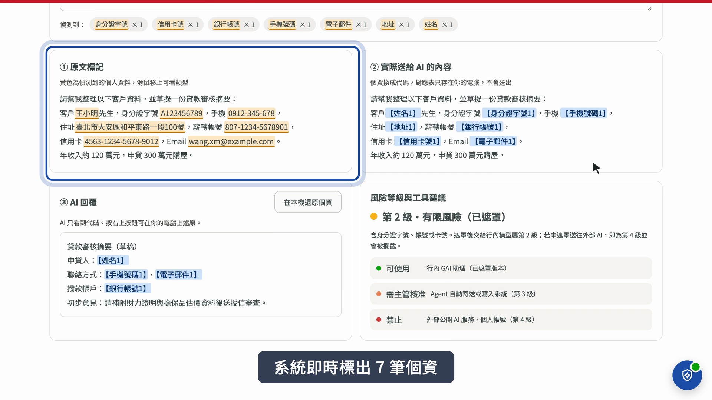
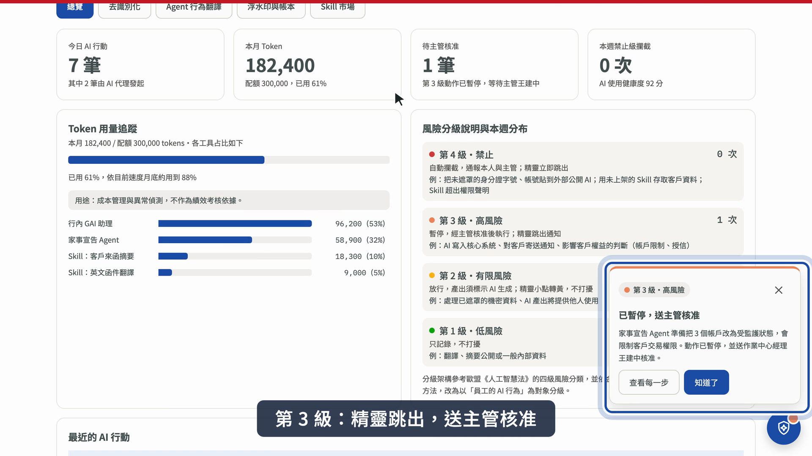
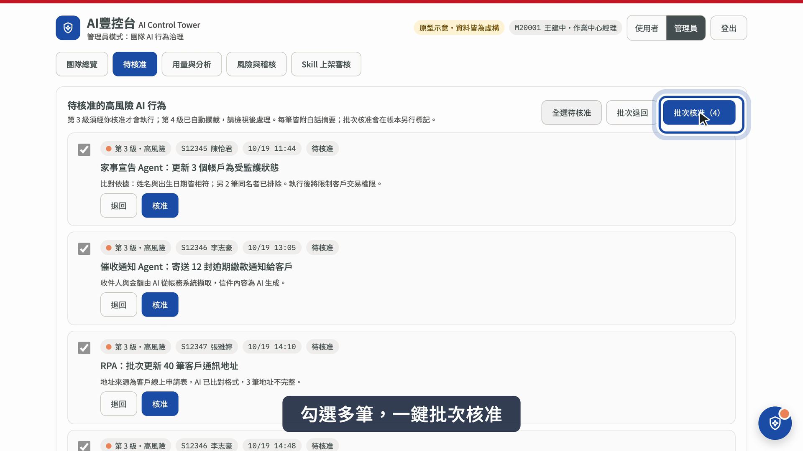

# AI豐控台 AI Control Tower

**讓每位行員看得懂、管得住自己的 AI 行動**
**Helping every bank employee understand and stay in control of what their AI does**

2026 永豐銀行策略人才競賽・金融科技提案　|　2026 Bank SinoPac Strategic Talent Competition · FinTech track

👉 **線上原型 Live prototype：<https://molannn.github.io/yongfeng-ai-sprite/>**

| 示範工號 Demo ID | 身分 Role |
|---|---|
| `S12345` | 一般同仁（作業中心專員 陳怡君） Employee (operations officer) |
| `M20001` | 主管（作業中心經理 王建中），可切換為管理員 Manager, can switch to admin view |

> 原型示意，所有人名、客戶與數字皆為虛構；在瀏覽器內執行，不連接任何真實系統。
> This is a concept prototype. All names, customers and figures are fictional. It runs entirely in the browser and connects to no real system.

[中文說明](#中文說明) ・ [English](#english)

---

## 中文說明

### 一句話

AI 正從資訊單位擴及全行，第一線員工控制不了 AI 的行為，卻要為結果負責。AI豐控台像機場塔台一樣記錄每一次 AI 行動，讓高風險動作在執行前經主管放行，並以內部 Skill 市場把同仁的 AI 經驗變成組織資產。

### 解決什麼問題

| 痛點 | 說明 |
|---|---|
| 看不見 | 一道 Agent 指令背後可能動用 OCR、外部 API、生成式 AI 與系統寫入，員工不知道查了哪些客戶資料、資料流向何處。 |
| 控制不了 | Agent 自動完成多個步驟，員工只在最後按確認，人工確認容易流於形式。 |
| 卻要負責 | AI 誤判（如同名同姓誤列受監護人）或個資外流時，責任仍落在員工身上。 |
| 責任難釐清 | 一般紀錄難以區分一筆查詢是員工輸入、AI 自行發起，還是模型錯誤。 |

### 5 分鐘試用路線

建議依序操作，可以看完整個流程：

| # | 操作 | 你會看到 |
|---|---|---|
| 1 | 點 `S12345`，按「以工號登入」 | 個人的「AI 行為護照」：今日 AI 行動、Token 用量與配額、待核准筆數 |
| 2 | 點「去識別化」→「使用範例」 | 系統即時標出 7 筆個資，送給 AI 的是代碼版本；按「在本機還原個資」把 AI 回覆換回真實資料 |
| 3 | 依序點上方「第 1 級」到「第 4 級」示範按鈕 | 第 1 級只記錄；第 2 級右下角小點轉黃；第 3 級精靈跳出、送主管核准；第 4 級直接攔截 |
| 4 | 點「Agent 行為翻譯」 | 家事宣告 Agent 的每一步白話說明、用到的技術、資料流向與 Token；同名同姓 2 筆交人工判斷 |
| 5 | 點「浮水印與帳本」→「驗證帳本完整性」 | 每筆紀錄標註「人工發起／AI 代理發起／AI 提出・人工核准」，雜湊鏈驗證未被竄改 |
| 6 | 點「Skill 市場」 | 同仁開發的 AI 工具，附權限聲明，依小組、部門、全行範圍共享 |
| 7 | 登出，改用 `M20001` 登入，點右上「管理員」 | 團隊總覽：主管只看中繼資料（工具、風險等級、Token），看不到對話原文 |
| 8 | 點「待核准」→「全選待核准」→「批次核准」 | 一次核准多筆第 3 級動作，批次核准在帳本另行標記 |
| 9 | 點「用量與分析」、「風險與稽核」→「產生稽核報告」 | Token 異常偵測（帳號盜用、Agent 迴圈）；對照《金融業運用 AI 指引》六大章節的稽核報告 |
| 10 | 登出，以 `S12345` 登入，點「Agent 行為翻譯」 | 剛才暫停的動作已核准並執行，帳本記下核准者 |

### 四級風險分級

參考歐盟《人工智慧法》四級架構，依金管會指引的風險基礎方法，改以「員工的 AI 行為」為分級對象。精靈只在第 3、4 級主動跳出，平常不打擾。

| 等級 | 行為例子 | 系統處理 | 精靈反應 |
|---|---|---|---|
| 🔴 第 4 級 禁止 | 未遮罩個資貼到外部公開 AI；Skill 超出權限聲明 | 自動攔截，通報本人與主管 | 立即跳出 |
| 🟠 第 3 級 高風險 | AI 寫入核心系統、對客戶寄送通知、影響客戶權益的判斷 | 暫停，經主管核准後執行 | 跳出通知 |
| 🟡 第 2 級 有限風險 | 處理已遮罩的機密資料、AI 產出將提供他人使用 | 放行，產出須標示 AI 生成 | 小點轉黃 |
| 🟢 第 1 級 低風險 | 翻譯、摘要一般資料 | 只記錄 | 不出現 |

### 三層架構

| 層次 | 服務對象 | 功能 |
|---|---|---|
| 第一層：個人防護 | 員工本人 | 隨行精靈、去識別化、行為翻譯、Token 追蹤、工號浮水印、個人帳本 |
| 第二層：管理治理 | 主管與金控 | 團隊總覽、第 3 級動作核准（可批次）、用量分析與異常偵測、稽核報告 |
| 第三層：共益生態 | 全行 | 內部 Skill 市場：同仁開發、四道關卡審核、依範圍共享 |

### 設計原則

- **與行內 AI 系統即插即用**：掛在「AI 與行內資料之間」的治理層，不是另一個 AI 工具，不重複建設。
- **隱私界線**：主管只看中繼資料，對話原文須經稽核授權才能調閱。
- **Token 不作績效考核**：用途是成本管理與異常偵測。
- **系統不替人判定責任**：帳本逐筆記錄指令者、發起來源與核准者，提供個案歸責所需的證據。

### 畫面截圖

| 去識別化 | 第 3 級精靈跳出 | 主管批次核准 |
|---|---|---|
|  |  |  |

### 原型範圍

這是展示操作流程與介面概念的原型，以下為模擬：登入（正式版接行內單一登入）、個資偵測（原型以規則比對，正式版加上中文 NER 模型）、Agent 執行紀錄、核准通知與稽核報告內容。重新整理頁面即回到初始狀態。

---

## English

### In one sentence

AI at the bank is spreading from IT to every department. Frontline employees cannot control what AI agents do, yet they are held responsible for the results. **AI Control Tower** works like an airport control tower: it records every AI action, makes high-risk actions wait for a manager's clearance, and turns employees' AI know-how into shared assets through an internal Skill marketplace.

### The problem

| Pain point | What it means |
|---|---|
| Can't see | One agent command may trigger OCR, external APIs, generative AI and system writes. Employees don't know which customer records were touched or where data went. |
| Can't control | Agents run many steps automatically; employees only click "confirm" at the end, so review becomes a formality. |
| Still accountable | When AI makes a mistake (e.g. flags the wrong person with the same name) or data leaks, the employee is still held responsible. |
| Unclear responsibility | Ordinary logs can't tell whether a query came from the employee, from the AI itself, or from a model error. |

### 5-minute walkthrough

The UI is in Traditional Chinese; button labels are given in quotes.

| # | Do this | What you'll see |
|---|---|---|
| 1 | Click `S12345`, then 「以工號登入」 (log in) | The employee's "AI passport": today's AI actions, token usage vs. quota, items awaiting approval |
| 2 | 「去識別化」 (de-identify) → 「使用範例」 (load sample) | 7 pieces of personal data are flagged instantly; the AI only receives placeholder codes. 「在本機還原個資」 restores the real values locally |
| 3 | Click the four demo buttons 「第 1 級」–「第 4 級」 at the top | Tier 1 is only logged; tier 2 turns the corner dot yellow; tier 3 pops up and waits for a manager; tier 4 is blocked |
| 4 | 「Agent 行為翻譯」 (agent translator) | Every step of a court-notice agent explained in plain language, with techniques, data flow and tokens; 2 same-name matches sent to human review |
| 5 | 「浮水印與帳本」 (watermark & ledger) → 「驗證帳本完整性」 (verify) | Each record is tagged human-initiated / AI-initiated / AI-proposed & human-approved; the hash chain verifies nothing was altered |
| 6 | 「Skill 市場」 (Skill marketplace) | Employee-built AI tools with permission declarations, shared by team, department or bank-wide |
| 7 | Log out, log in as `M20001`, click 「管理員」 (admin) | Team overview: managers see metadata only (tool, risk tier, tokens), never conversation content |
| 8 | 「待核准」 (pending) → 「全選待核准」 (select all) → 「批次核准」 (batch approve) | Approve several tier-3 actions at once; batch approvals are marked separately in the ledger |
| 9 | 「用量與分析」 (usage), then 「風險與稽核」 (risk & audit) → 「產生稽核報告」 | Token anomaly detection (account misuse, agent loops) and an audit report mapped to the six chapters of Taiwan FSC's AI guidelines for financial institutions |
| 10 | Log out, log in as `S12345`, open 「Agent 行為翻譯」 | The paused action is now approved and executed; the ledger records who approved it |

### Four risk tiers

Modeled on the EU AI Act's four-tier structure and the FSC's risk-based approach, but applied to **employees' AI behavior**. The assistant only pops up for tiers 3 and 4.

| Tier | Example | System response | Assistant |
|---|---|---|---|
| 🔴 4 Prohibited | Pasting unmasked personal data into a public AI; a Skill exceeding its declared permissions | Blocked automatically; employee and manager notified | Pops up immediately |
| 🟠 3 High | AI writing to core systems, emailing customers, decisions affecting customer rights | Paused until a manager approves | Pops up |
| 🟡 2 Limited | Handling masked confidential data; AI output shared with others | Allowed; output labeled as AI-generated | Dot turns yellow |
| 🟢 1 Low | Translating or summarizing general content | Logged only | Stays hidden |

### Three layers

| Layer | For | Features |
|---|---|---|
| 1. Personal protection | Employees | Assistant, de-identification, agent translator, token tracking, employee-ID watermark, personal ledger |
| 2. Management | Managers & group | Team overview, tier-3 approvals (incl. batch), usage analytics & anomaly detection, audit reports |
| 3. Shared ecosystem | Whole bank | Internal Skill marketplace: built by staff, four review gates, shared by scope |

### Design principles

- **Plugs into existing bank AI systems**: a governance layer between AI and bank data, not another AI tool.
- **Privacy boundary**: managers see metadata only; conversation content requires audit authorization.
- **Tokens are not a performance metric**: they are for cost control and anomaly detection.
- **The system provides evidence, not verdicts**: the ledger records who gave the command, who initiated each step and who approved it.

### Screenshots

| De-identification | Tier-3 pop-up | Manager batch approval |
|---|---|---|
|  |  |  |

### Prototype scope

This prototype demonstrates the user flow and interface concept. Simulated parts: login (production would use the bank's single sign-on), personal-data detection (rule-based here; production adds a Chinese NER model), agent execution logs, approval notifications and audit report content. Refreshing the page resets everything.

---

## 檔案 Files

| 路徑 Path | 說明 Description |
|---|---|
| `index.html` | 原型本體，單一 HTML 檔，可直接用瀏覽器開啟 The prototype, a single self-contained HTML file |
| `docs/` | README 使用的截圖 Screenshots used in this README |
